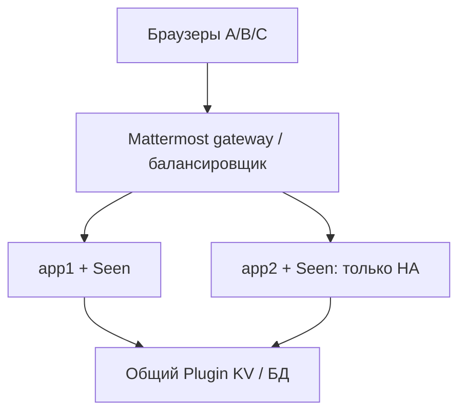

# Проверка Seen 1.0.2 на тестовом Mattermost

Дата: 29.09.2026. Статус: **ready to execute**; тесты на вашем контуре ещё не выполнены. Plugin ID: `ru.internal.mattermost.seen`.

## Краткий вывод и порядок

Сначала выполнить установку и настройки T01–T06, затем основной пользовательский прогон T07–T19, безопасность T20–T26. HA и нагрузка T27–T33 — отдельный этап, только если соответствующий контур доступен. Отсутствующий сценарий отметить NOT RUN/BLOCKED/N/A с причиной, не PASS.

Версия 1.0.2 добавляет явное `Сегодня, 11:24` / `Today, 11:24`. Настройки `RetentionDays` и `EnablePublic` уже были в manifest; уточнены подписи и добавлены регрессионные проверки загрузки/валидации конфигурации. Backend receipts, plugin ID и viewport dwell не изменены относительно 1.0.1.

Локальные automated tests и mock-host browser tests не заменяют этот прогон. Зафиксировать результат в `results.csv`: фактический результат, evidence и отклонения. Не включать credentials, cookies, реальный текст переписки и списки сотрудников в передаваемые журналы.

## Область применения и схема

Цель — проверить web/desktop UI, System Console, Mattermost gateway и сохранённые receipts. Mobile collection и Connected Workspaces receipt sync не заявлены.



При single-node app2 отсутствует; HA-тесты N/A, это не доказательство HA. В HA обе ноды должны работать с общей writable DB. Фактические адреса, прокси, replica topology и настройки кластера не предоставлены, их необходимо записать в локальный протокол перед проверками.

## Подготовка и backup

1. Зафиксировать Mattermost version/build, plugin version, число app-нод, browser/desktop version, timezone и язык аккаунтов, прежние значения настроек. Проверить, что это тестовый контур.
2. Сохранить предыдущий plugin archive, значения настроек и подтвердить штатный backup БД; восстановление БД не является частью обычного теста плагина.
3. Подготовить три обычных non-admin/non-bot аккаунта: A — автор, B — читатель, C — outsider. Администратор используется отдельно только для установки/конфигурации. Работать в разных browser profiles; две вкладки одного профиля обычно имеют общую сессию.
4. Создать изолированный приватный канал с A/B, без C; DM A↔B; group DM A/B/C; публичный тестовый канал A/B. Для проверки второго viewer в приватном канале временно добавить C только после outsider-тестов либо использовать четвёртый аккаунт D.
5. Создать синтетические сообщения с метками Txx. Сохранить их ссылки локально. Для privacy-тестов убедиться, что C действительно не имеет доступа и не является участником выбранного канала.
6. Для календарных проверок нужны receipts сегодня и вчера. Старое сообщение с первым просмотром сегодня должно показывать **Сегодня**: возраст сообщения и дата просмотра различаются. Если вчерашнего receipt нет, запланировать повтор на следующий день; не менять server clock и не править БД.
7. На время настроечных тестов исключить чужую активность в тестовых каналах. Сохранить исходные TeamSettings и plugin settings для возврата.

## Установка

На инженерной Linux-машине рядом с архивом и файлом контрольных сумм проверить целостность:

```sh
sha256sum -c SHA256SUMS-1.0.2.txt
```

Ожидается `OK` для всех присутствующих файлов из списка; при отсутствии source/test ZIP положить их рядом либо отдельно сверить строку installable TAR.GZ. Checksum подтверждает целостность, не происхождение.

Если обновление идёт с 1.0.0, отключить plugin cluster-wide, обновить все app-ноды и только затем включить: старые writers не понимают tombstone. Для приёмки использовать согласованную 1.0.2 на всех нодах. Загрузить `.tar.gz` через System Console, проверить enabled/version, затем reload клиентов. Само приложение Mattermost этим пакетом не перезапускается.

## Где находятся настройки

Под System Admin открыть **System Console → Plugins → Seen** либо страницу настроек Seen, доступную из списка плагинов. Точное расположение пункта зависит от сборки/локализации; поля задаются `settings_schema` в manifest, это не пользовательские настройки аккаунта.

- **Срок хранения просмотров, дней (`RetentionDays`)**: целое число 1–365, default 90. Отсчёт от **создания сообщения**.
- **Просмотры в публичных каналах (`EnablePublic`)**: default true. При false не учитывать public channels; DM/group/private продолжают работать.

После Save заново открыть страницу и проверить значение, затем проверить поведение UI/API. При `ReadOnlyConfig` или управляемой конфигурации консоль может не разрешить запись — это BLOCKED конфигурацией контура, не автоматически дефект Seen. Использовать штатный процесс изменения конфигурации; не отключать защиту ради теста.

## Конфигурация — обязательный блок

| ID | Действия | Ожидается | Доказательство |
|---|---|---|---|
| T01 | Установить 1.0.2, открыть список плагинов и страницу Seen | Прежний ID, версия 1.0.2, enabled; оба поля доступны | Скрин версии и полей |
| T02 | На чистой установке проверить defaults; на upgrade сверить прежние значения | Чистая: 90/true; upgrade не должен сбросить сохранённую настройку | До/после |
| T03 | Сохранить RetentionDays=30, закрыть/открыть настройки | 30 сохранено; plugin работает, handler применил конфигурацию | Скрин + успешный новый receipt |
| T04 | На сообщении старше 1 суток с ещё существующей историей временно установить RetentionDays=1, открыть список заново | История недоступна как expired; новые receipts для слишком старого post не считаются успешными. Текущее сообщение продолжает работать | UI и JSON state; без старого fixture — BLOCKED |
| T05 | Временно проверить 0, -1, 366, дробное значение; затем вернуть допустимое | Недопустимое значение не становится active config. UI может отклонить ввод или host может сохранить config при ошибке hook — проверить поведение, не только уведомление Save | Ошибка/активное поведение; перед перезапуском обязательно вернуть валидное значение |
| T06 | Выключить EnablePublic, проверить public + DM + private на новых сообщениях, затем вернуть true и проверить новый post | Public disabled; в DM/private просмотр работает; после включения public вновь работает | По одному тестовому post каждого типа |

Верхнюю допустимую границу 365 и нижнюю 1 проверить сохранением без ожидания истечения. Увеличение retention не обязано восстановить старые receipts: физический TTL мог уже сработать, а существующий deadline не продлевается автоматически. Для проверки persistence после рестарта plugin использовать только допустимое значение, например 30; новый просмотр и old receipt остаются корректными.

## Функциональность и UI

| ID | Подготовка и действия | Ожидается |
|---|---|---|
| T07 | A отправляет новый post; B ещё не открывал его viewport. A открывает индикатор | Серые галочки; «Пока не просмотрено»/Not viewed yet; нет Previous/Next/лишней Close-кнопки при пустом списке |
| T08 | B открывает post и оставляет окно активным на 2 секунды; A открывает viewers | Один B, счётчик 1, `Сегодня, HH:mm`. Автор A отсутствует. Учитывается маркер viewport, не гарантированное человеческое чтение |
| T09 | В Network у A сохранить `seen_at` B числом; через >5 секунд B повторно открывает post | Count и **точное seen_at** прежние; сравнение только HH:mm недостаточно |
| T10 | Другой разрешённый читатель просматривает тот же post позже | Два уникальных viewer, сортировка по первому timestamp; при равных timestamps порядок детерминирован |
| T11 | Открыть вчерашний receipt, затем более старый; сравнить tooltip с timezone профиля | Вчера/Yesterday; ранее dd.mm; другой год dd.mm.yyyy. Секунды/полная дата доступны в tooltip/aria-label |
| T12 | У A изменить timezone так, чтобы реальный receipt попал по другую сторону полуночи; reload/open | Календарная подпись и время меняются по timezone A, серверное seen_at неизменно. Вернуть timezone |
| T13 | Сменить язык A ru/en; проверить имена по TeamSettings.TeammateNameDisplay | Сегодня/Today, Вчера/Yesterday; full_name/nickname_full_name/username и непустой fallback. Вернуть host setting |
| T14 | Новое сообщение B быстро прокручивает мимо <800 ms; отдельно держит в скрытой вкладке/неактивном окне | Не должен появиться receipt до непрерывного выполнения условий видимости/фокуса. После нормального просмотра — появляется |
| T15 | Тестовые plain text, многострочный Markdown, ссылка, вложение, длинное имя | Индикатор рядом с концом обычного текста; fallback для неподдерживаемого layout допустим. Дата не перекрывает имя, имя может ellipsis, полное имя в tooltip |
| T16 | Light/dark; 100% и 125% zoom; открыть клавиатурой, ESC, клик снаружи | Контраст читаем; popover не обрезан; закрытие работает; фокус возвращается на trigger; Tab доступен |
| T17 | 3 viewer, затем список >50 реальных тестовых пользователей при наличии fixture | Малый список целиком; большой max-height/scroll без Previous/Next; подгрузка следующих страниц, уникальные строки и порядок. Без >50 fixture — BLOCKED только большая часть теста |
| T18 | В DevTools у A заблокировать только endpoint viewers, открыть список, затем убрать блокировку и Retry | Loading/error state; retry восстанавливает список; предыдущие данные помечены stale при ошибке refresh |
| T19 | Открыть список, редактировать post; затем многократно открыть/закрыть и переключить каналы | Нет дублирующихся индикаторов/накопления одинаковых запросов; ESC/click outside продолжают работать |

Для перехода Сегодня→Вчера оставить тестовый список открытым через локальную полночь либо повторить на следующий день: подпись должна измениться в пределах следующего 30-секундного UI tick, с учётом browser throttling скрытых вкладок. В изолированных frontend tests этот переход можно моделировать; **не менять часы сервера Mattermost**.

## API security через реальный gateway

Использовать Network → запрос к `/plugins/ru.internal.mattermost.seen/api/v1/…`. Скопировать структуру запроса только локально, заменить тестовый post_id при необходимости. Сессионные заголовки не пересылать. Проверять содержимое ответа, а не только общий HTTP 200: batch возвращает per-post status.

| ID | Действия | Ожидается |
|---|---|---|
| T20 | Без сессии запросить viewers; повторить с подставленным Mattermost-User-ID A | Отказ без viewer data. Gateway не доверяет входному identity header |
| T21 | Под B получить viewers post A; повторить с подставленным UID A в header; под C повторить для приватного post | B/C не получают viewers; header не меняет identity. У плагина обычно 404; дополнительный gateway denial также фиксировать |
| T22 | Под B/C запросить POST summaries для post A | Нет раскрытия summary чужого/недоступного сообщения, даже если HTTP 200 и пустой summaries |
| T23 | Под B в body receipt добавить user_id=A; отдельно передать невалидный post_id | 400, без записи от A; штатный body принимает только post_ids |
| T24 | Cookie-auth POST без X-CSRF-Token и X-Requested-With; затем неверный CSRF; затем штатный запрос | При строгом CSRF — отказ некорректным и успех штатному. Зафиксировать strict/legacy host policy. Не использовать Authorization bearer для этого теста: его контракт другой |
| T25 | A покидает приватный канал после наличия receipts; попытаться открыть viewers/summaries | Прежнее авторство не даёт доступ без актуального membership/read permission; старые данные UI очищаются при denied |
| T26 | На отдельном тестовом post получить receipt, удалить post; повторить viewers и receipt request | Viewer API отказывает, receipt не подтверждается как новый успешный. Это проверяет API, но **не доказывает** отсутствие KV resurrection при гонке |

Если при cookie-тесте оставлен Authorization header, результат нельзя записывать как CSRF PASS. Не менять глобальную strict CSRF policy без отдельного согласования на тестовом контуре. Если политика не известна — BLOCKED/нужно уточнение.

## HA / race / нагрузка — отдельный этап

Эти проверки могут влиять на доступность тестового сервиса. Выполнять в выделенное окно с backup и известной процедурой восстановления; не выполнять на production в рамках этого набора.

| ID | Действия | Ожидается / предел вывода |
|---|---|---|
| T27 | Направить запросы A/B через разные app-ноды штатным механизмом балансировщика, повторить один user/post | Один receipt, тот же first timestamp. Зафиксировать фактическую ноду в локальном протоколе, не угадывать её по URL |
| T28 | После write acknowledgement перезапустить один plugin/app process по штатному runbook, прочитать через другую ноду | Committed receipt сохранён; UI восстанавливается. Пропавшая недоставленная browser queue не является потерей committed receipt |
| T29 | Параллельно отправлять ограниченную серию repeats B и удалить отдельный post A; проверить storage штатной диагностикой Plugin KV | После successful tombstone viewer data не восстановлены. Без storage evidence отметить PARTIAL: 404 API не доказывает физическую очистку |
| T30 | В изолированном стенде имитировать DB failure/replica lag и восстановление | Ошибки/retry вместо ложного acknowledgement; после восстановления нормальная работа, без дублей. Без стенда — NOT RUN, не вводить сетевые блокировки на общем контуре |
| T31 | При заранее согласованной нагрузке повторять запросы одним user, параллельно другим | 429/Retry-After ограничивают первого; второй сохраняет доступ. Лимит per-process: 2/sec, burst 120, не cluster-wide. Не считать достижение 429 само по себе performance PASS |
| T32 | Загрузить >50 viewers, дождаться refresh без изменения данных, затем добавить viewer | Неизменный список — один запрос первой страницы на refresh; после изменения — необходимые страницы; scroll/focus сохраняются |
| T33 | После серии mount/unmount и disable/enable сравнить Network и browser memory snapshots | Нет продолжающихся plugin requests после uninitialize, бесконтрольного накопления listeners/observers. Cache warming само по себе не memory leak |

Нагрузочные SLA (p95, error rate, число users) выбрать **до** прогона под возможности стенда. Этот документ не задаёт выдуманные измеренные показатели. Разные app-ноды не должны использовать разные независимые БД.

## Retention и очистка

**T34.** На отдельном fixture проверить storage expiry и поведение при снижении retention. Сравнить `expired` в API и физическое наличие данных штатным инструментом диагностики Plugin KV. Не читать `users` напрямую и не изменять системную схему. Если такого инструмента нет, зафиксировать только logical expiry, а physical cleanup оставить NOT RUN.

**T35.** Удалить отдельного тестового пользователя/канал только при заранее подготовленном расходном fixture. Зафиксировать известное ограничение: dedicated erasure flow отсутствует. Не ставить PASS «мгновенная очистка всех receipts»; ожидаются запрет доступа/retention semantics, а не гарантированное физическое удаление. Backup retention проверяется отдельно по политике backup.

## Результаты и критерии допуска

Для обычного тестового использования обязательны T01–T10, доступные календарные T11–T13, T14–T16, T18–T26. Если вчерашнего receipt нет, календарную часть оставить открытой до следующего дня. Для утверждения HA support дополнительно обязательны применимые T27–T30. Большие каналы требуют T17/T31/T32. Невыполненные требования и известные ограничения перечислить явно.

Остановить rollout при раскрытии viewers неавтору/outsider, подмене identity, изменении first timestamp повтором, дублях, потере committed receipts или неприменении валидной конфигурации. Обычное ограничение 429 при целевой нагрузке требует настройки/оптимизации, а не игнорирования результата.

## Завершение и rollback

Вернуть RetentionDays, EnablePublic, TeamSettings, timezone и язык к исходным значениям. Снять блокировки Network/Offline. Удалить только созданные тестовые сообщения/каналы штатным UI после сохранения результатов. Отключение plugin останавливает сбор новых просмотров; архив и БД сами по себе не очищаются.

При проблеме отключить Seen и сохранить обезличенную диагностику. Для 1.0.2 допустимый первый кандидат отката — сохранённая 1.0.1 (тот же tombstone-aware backend), сначала проверить её на том же стенде и перезагрузить клиенты. Откат на 1.0.0 с активными writers отменяет защиту tombstone и не рекомендуется. Восстановление всей БД затрагивает Mattermost целиком и выполняется только отдельной recovery-процедурой.

## Troubleshooting

| Симптом | Что проверить |
|---|---|
| Нет полей Seen в System Console | System Admin, installed version/manifest, отдельная страница настроек, reload консоли; не искать их в настройках обычного пользователя |
| Save недоступен | Права, ReadOnlyConfig/управляемая конфигурация; не обходить host policy |
| Невалидное значение сохранилось в host config | Вернуть допустимое до перезапуска; проверить hook error и фактический active config. Сохранение JSON не равно успешному применению |
| После обновления по-прежнему только HH:mm | Версия webapp/client cache, reload, одинаковый пакет на app-нодах |
| Старое сообщение показывает Сегодня | Возможно, первый receipt получен сегодня; сравнить seen_at, не CreateAt сообщения |
| Увеличение retention не вернуло историю | TTL мог уже истечь; продление не восстанавливает удалённые данные |
| 429/503 при тесте | Retry-After, DB/KV и нагрузка; не запускать бесконечный retry loop |

Основание expected results: текущие manifest/server/webapp исходники 1.0.2, автоматические проверки и ограничения аудита 1.0.0. Фактическое поведение конкретной сборки Mattermost gateway/HA/консоли подлежит этому live-прогону.
