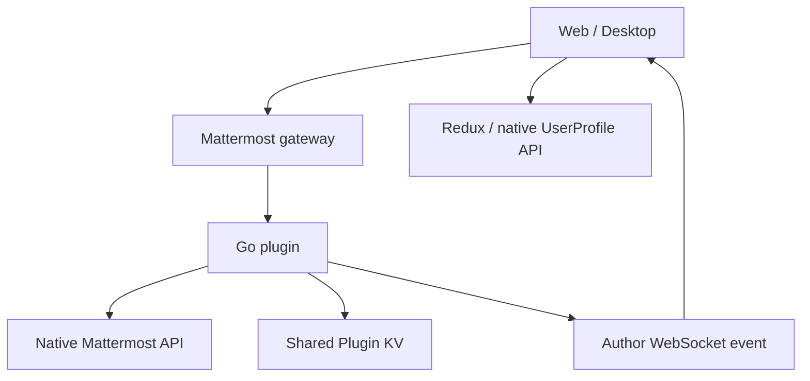
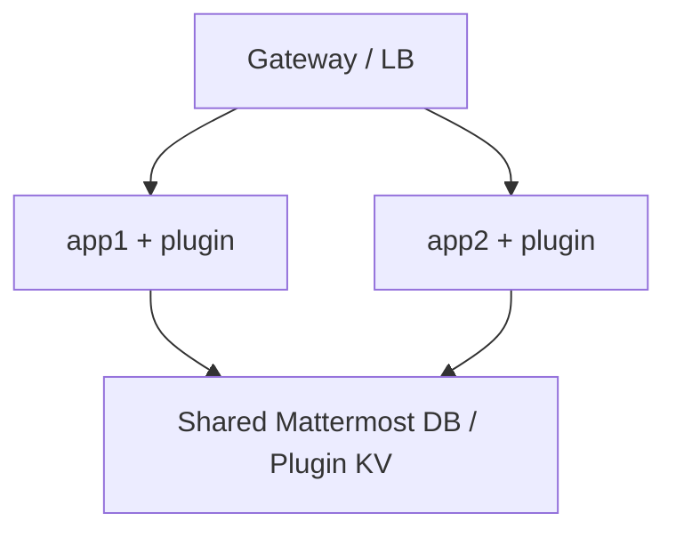

# Архитектура

База: 1.0.3; проверка исходников 01.10.2026. Схема описывает проект, а не обследованный рабочий контур.

## Поток данных

Webapp регистрирует attachment-компонент и наблюдает за его маркером. Условия штатного клиента: видимость не менее 50%, непрерывно 800 мс, активное окно и видимая вкладка. Измеряется маркер, а не прочтение всего текста. Автор не создаёт receipt самому себе. Аутентифицированный клиент может самостоятельно вызвать API для доступного сообщения — сервер не доказывает человеческое прочтение.

`runtime.ts` объединяет отправку по 50 post IDs, использует очередь с ограниченным временем жизни и повторные попытки. `index.tsx` управляет lifecycle, shared IntersectionObserver, событиями, запросами и UI. `viewer_session.ts` управляет загрузкой/обновлением списка; `profile_cache.ts` объединяет profile-запросы. Имена получает frontend через Redux и `/api/v4/users/ids`; backend viewers выдаёт ID и timestamp.

`plugin.go` проверяет пользователя, сообщение, членство и read permission; `store.go` хранит map user→timestamp. CAS (compare-and-set) записывает новый документ только если прочитанная версия не изменилась. До 8 попыток разрешают конкурирующие записи; исчерпание попыток приводит к retry, а не к ложному успеху. Время берётся на сервере при попытке записи; повторный receipt сохраняет записанное значение.

## UI и жизненный цикл

Имя: configured display → full name → nickname → username → user_id. Профильные строки рендерятся React как текст. Сегодня/вчера вычисляются в выбранной пользовательской timezone; timestamp хранится в миллисекундах Unix. Сортировка возрастающая по `seen_at`, при равенстве по `user_id`.

`inline.ts` добавляет только собственный контейнер в последний P/SPAN сообщения и наблюдает локальный subtree. Есть зависимость от DOM Mattermost 11.10; сложные блоки сохраняют attachment fallback. Это область обязательной проверки при обновлении Mattermost. Обработчики, observers, таймеры и запросы очищаются при uninitialize; факт отсутствия утечек на длительной рабочей сессии пока не доказан.

## Хранение и HA

Single-node использует ту же логику без app2. Подтверждённые receipts находятся в Plugin KV; локальные очереди до подтверждения недолговечны. Ограничители запросов и caches локальны процессу. Распределённая квота не реализована. Реальная межнодовая согласованность, маршрутизация reads и доставка WebSocket требуют тестов конкретного Mattermost-кластера.

## Ограничения стоимости

Один документ на post, до 5000 viewers; запись сериализует весь документ. Авторизация выполняет native API lookup для каждого post; batching уменьшает HTTP, но не устраняет backend lookups. Viewers API сортирует весь retained список перед выбором страницы. Неизменившийся список определяется по content version; изменившийся большой список может потребовать до 100 страниц. Это рабочая модель для ограниченных нагрузок, но её масштабируемость не подтверждена нагрузочным тестом.

Критические инварианты для изменений: один user+post = один receipt, автор исключён, timestamp не перезаписывается, все чтения повторно авторизуются, tombstone нельзя перезаписать обычным writer, plugin ID неизменен.
