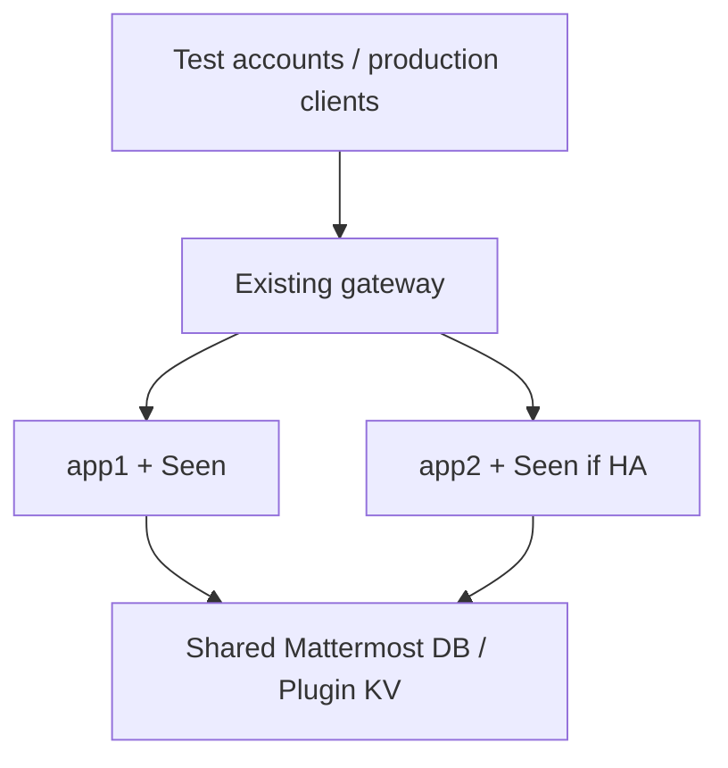

# Эксплуатационный ранбук Seen 1.1.2

Версия документа: 3; дата: 12.10.2026; статус: инструкция к pre-release / not applied. Контур: изолированный тестовый Mattermost, затем production после приёмки. Документ подготовлен по исходникам и требованиям CI, не по обследованию сервера. Состояние фактического прогона проверять по Actions и отчёту конкретного релиза.

## Вывод и область

Устанавливается плагин author-only viewport receipts. Цель - проверить поведение на конкретной версии Mattermost до широкого включения. Целевая версия сервера 11.10.x, manifest minimum 11.10.0; server binaries Linux amd64/arm64. Web/Desktop; mobile receipts и Connected Workspaces sync не поддерживаются. Rollback по умолчанию - отключение плагина, без удаления данных.

## Текущая и целевая схема

Текущая: Mattermost с неизвестной здесь топологией и прежней версией плагина. Целевая: тот же Mattermost, API и общая БД, Seen 1.1.2 на всех app-нод. Сетевые маршруты и DB endpoints этим изменением не меняются. Для тестового/боевого контура отдельно записать версию, node count, gateway и способ backup.



В single-node app2 отсутствует. Shared file storage не заменяет общую DB. Точки отказа - существующие gateway/DB/app, плюс plugin process для функций Seen. HA не считать проверенным без отдельного прогона.

## Pre-check и backup

1. Записать Mattermost build, plugin version, архитектуру app-нод, состояние плагина, RetentionDays/EnablePublic и доступность тестовых аккаунтов A/B/C.
2. Проверить штатную доступность Mattermost, login, сообщения, native profiles и WebSocket. При исходном сбое сервиса отложить обновление.
3. Убедиться, что upload разрешён политикой сервера, есть системный администратор, конфигурация writable либо известен управляемый способ её изменения.
4. Сохранить предыдущий проверенный архив и настройки. Подтвердить актуальный backup БД и процедуру восстановления; пути/credentials взять из локального backup-runbook. В этом документе команды с вымышленным DB name не приводятся.
5. Согласовать короткое окно отсутствия индикаторов/сбора receipts. Зафиксировать критерий rollback: ошибки доступа, неверные viewers, массовые 5xx, деградация UI/сервера.

На инженерной Linux-машине, рядом с релизным архивом и поставляемым файлом сумм, проверить целостность. Для GitHub-комплекта скачать install-архив, source ZIP, отчёт проверки и файл сумм в одну папку. Для локальной сборки использовать её dist/SHA256SUMS из корня checkout.

```sh
sha256sum -c SHA256SUMS-1.1.2-github.txt
```

Ожидаемый результат: `OK` для install-архива, source ZIP и `release-validation-1.1.2.json`, exit code 0. Контрольная сумма должна происходить из доверенного релиза; сама по себе не доказывает авторство. Для нового комплекта использовать `SHA256SUMS-1.1.2-github.txt`; хранить его рядом с файлами, указанными внутри. Для прошлых комплектов использовать их исходные файлы сумм.

## Установка / обновление

1. Для перехода с 1.0.0 выключить плагин cluster-wide, обновить все app-ноды, затем включить. Не оставлять старые writers с новыми tombstones. Для остальных обновлений также предпочесть согласованное окно и проверить одинаковую версию на нодах.
2. Загрузить `ru.internal.mattermost.seen-1.1.2.tar.gz` через System Console → управление плагинами как обновление того же ID. Не загружать ZIP исходников/документации вместо install bundle.
3. Убедиться в отображаемой версии 1.1.2 и enabled state. Если upload не дал ясного результата, сначала проверить список/логи, не считать молчание успешной установкой.
4. Открыть настройки Seen, установить RetentionDays (1-365, default 90) и EnablePublic (default true), сохранить и повторно открыть страницу. Срок от даты создания сообщения. Read-only config может препятствовать сохранению.
5. Перезагрузить Web/Desktop clients. После смены аккаунта требуется полный reload. Плагин не требует системной SQL-миграции.

## Post-check / критерий завершения

A отправляет синтетическое сообщение B. Пока B не открыл сообщение - серые галочки. При видимом маркере ≥800 мс в активном окне - появляется B, имя из UserProfile, Сегодня и время. Повторный просмотр не меняет время/count. A не считается viewer. Пользователь C без доступа не получает viewers; B не получает viewers чужого сообщения.

Проверить group/private/public, thread/RHS, светлую/тёмную тему, ESC/click outside/keyboard, scroll, длинный текст и complex markup fallback. Пройти [полную матрицу](testing.md), зафиксировать реальные результаты. Отсутствие записи после перезагрузки/offline может быть потерей недоставленной очереди, а не потерей сохранённого receipt.

Завершение: сценарии обязательной приёмки PASS, версия/настройки подтверждены, ошибок/degradation нет, результаты сохранены. Невыполненное - NOT RUN/BLOCKED, не PASS.

## Отключение и rollback

Выключить Seen через управление плагинами и перезагрузить клиент. Проверить обычные сообщения/login Mattermost. Данные KV не удалять. Сохранить обезличенные симптомы и временной диапазон. При проблеме нового пакета сначала оставить плагин выключенным. Переход к ранее проверенному 1.1.1 совместим с текущим KV и сохраняет его dependency fixes; выполнять только после проверки exact пакета, согласования окна и проверки всех app-нодах. Возврат к 1.0.1-1.1.0 структурно совместим с KV, но возвращает найденные dependency vulnerabilities и не считается закрытым security rollback. Возврат к 1.0.0 с writers нарушает tombstone-защиту и не является допустимым обычным rollback.

Восстановление всей БД не входит в обычный rollback: оно может откатить сообщения и другие данные Mattermost. Выполнять только по отдельному аварийному плану. Restart Mattermost не предписан как штатный шаг; если конкретный deployment требует restart, учитывать его доступность и окно влияния.

## Риски и диагностика

Источник оценки: код 1.1.2, mock tests, ограничения host API. На живом контуре требует подтверждения.

| Область | Что заметит пользователь / риск |
|---|---|
| Данные | Неподтверждённые receipts теряются при reload; retention не равен удалению backup |
| Доступность | При отключении Seen пропадают его функции; влияние обновления host зависит от deployment |
| Производительность | Большие списки и burst чтений создают KV/native API нагрузку |
| UX | Незнакомая DOM-разметка даёт footer fallback; viewed не означает человеческое чтение |

| Симптом | Вероятная причина | Проверка / действие |
|---|---|---|
| Upload без результата | Ошибка разрешения, manifest/architecture или сервера | Network status upload, список плагинов, логи по точному времени/ID; не публиковать HAR с токенами |
| Остались старые галочки | Старый web bundle | Версия на сервере и всех нодах, reload клиента |
| Нет нового просмотра | Неактивное окно, маркер невиден, expiry/public disabled | Проверить условия, настройки, per-item status batch |
| Нет имени | Native profile недоступен/не заполнен | Redux/API permissions, fallback до user_id ожидаем |
| 401 / 404 | Сессия или ограничения доступа | Проверить текущий аккаунт, автора и membership; не обходить проверки |
| 429 | Локальная квота/конкуренция | Retry-After, частота запросов; не запускать tight retry loop |
| 503 / retry | Host API/KV или конкурирующие записи | Логи Mattermost/DB, latency и cluster health |
| После удаления остались физические данные | Ошибка cleanup/backup policy | Проверить kv_tombstone warning и штатные сроки хранения; не править SQL вручную |

Фильтровать логи штатным инструментом deployment по `Seen` и plugin ID, интервалу инцидента. Не предполагать systemd, конкретный service name или путь логов без проверки. Future work: [roadmap](roadmap.md).
